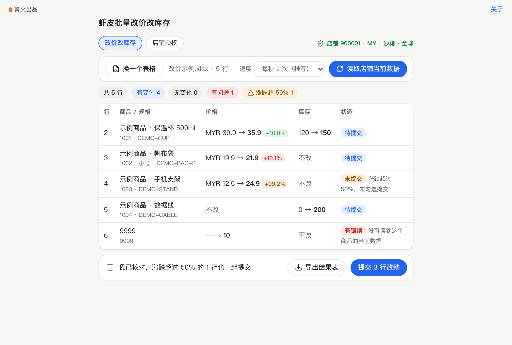

# 虾皮批量改价改库存

> 篝火出品 · 收录于篝火 App 应用区

走 Shopee 官方接口



## 下载

到 [Releases](https://github.com/campfire-code/shopee-batch-price/releases/latest) 下载对应安装包：

| 电脑 | 文件 |
|---|---|
| Windows 10 / 11 | `shopee-batch-price_版本号_windows-x64-setup.exe` |
| Mac（Apple 芯片） | `shopee-batch-price_版本号_mac-arm64.dmg` |
| Mac（Intel 芯片） | `shopee-batch-price_版本号_mac-x64.dmg` |

第一次打开：
- **Windows**：如果弹出「Windows 已保护你的电脑」，点「更多信息」→「仍要运行」。
- **Mac**：如果提示「无法验证开发者」，打开「系统设置 → 隐私与安全性」，在下方点「仍要打开」。

## 怎么用

**使用前要先准备（工具无法代办）：**
1. 在 Shopee 开放平台（open.shopee.com，中国大陆卖家用 open.shopee.cn）注册开发者账号，创建应用并通过审核，拿到 Partner ID 和 Partner Key。应用需要有商品管理（Product）相关权限；具体申请流程与审核要求以平台为准（未核实）。
2. 在应用里填好授权回跳地址（Redirect URL），本工具里要填同一个地址。
3. 有一个已入驻的卖家店铺账号，用来授权。

**操作步骤：**
1. 打开「店铺授权」页：选环境和店铺站点，填 Partner ID、Partner Key、回跳地址。
2. 点「打开授权页」，用卖家账号登录并确认授权。浏览器跳转后，把地址栏里的完整网址复制，粘贴回工具，点「换取令牌」。成功后页面显示店铺 ID 和令牌有效期。令牌过期时工具会自动刷新。
3. 回到「改价改库存」页，把表格（.xlsx 或 .csv）拖进窗口。表头必须有「商品ID」，以及「新价格」「新库存」至少一列；多规格商品再加「规格ID」或「规格货号」；库存分仓时加「仓库ID」。留空表示这项不改。
4. 点「读取店铺当前数据」。工具逐个查询商品，生成对比表：原价 → 新价（含涨跌幅）、原库存 → 新库存，并标出有问题的行（缺规格、规格重复、商品不存在等）。
5. 涨跌幅超过 50% 的行默认不提交，需要勾选「我已核对…」才会一起提交。
6. 点「提交 N 行改动」，确认后按商品逐个提交（每个商品一次改价、一次改库存）。提交会真实修改店铺，无法撤销，正式店铺建议先用沙箱环境或少量商品试。
7. 完成后点「导出结果表」，在原表格所在文件夹得到「虾皮改价结果-日期-时间.xlsx」，每行有成功、失败及失败原因。

**说明与限制：**
- 价格只改原价（original_price）；库存只改卖家库存（seller_stock）。
- 价格小数位：新加坡、马来西亚、巴西、墨西哥、波兰、西班牙、阿根廷可到两位小数，其他站点只能整数（取自官方 update_price 接口说明）。
- 请求速度可选每秒 1 / 2 / 5 / 10 次；平台未公布这几个接口的具体限流（未核实），遇到限流请调低速度。
- 沙箱环境的接口域名取自上游开源项目 shopee-sdk，未能在官方文档上再次核对（未核实）。
- Partner Key 和令牌只保存在本机设置文件，不上传，日志里不输出。


## 验收用例

用 `samples/改价示例.xlsx`（同内容的 `改价示例.csv` 结果相同）。表里 7 行：1001、1002（3 行，含 1 个规格ID、1 个规格货号）、1003、1004、1005、1006（价格填了 `abc`）。示例商品 ID 是虚构的，需要换成你自己店铺里真实的商品ID 和规格ID。

1. 不授权也能验证表格检查：把示例表拖进「改价改库存」页（未授权时程序默认停在「店铺授权」页，先点上方「改价改库存」标签）。应提示「读到 7 行，其中 1 行有问题」，表格里第 8 行显示「新价格不是数字」，其余 6 行显示「格式正确」。
2. 授权后，把示例表里的商品ID 换成沙箱或测试店铺里的商品，点「读取店铺当前数据」。应出现对比表，统计条显示共 N 行、有变化 / 无变化 / 有问题的数量；表里不存在的商品显示「没有读到这个商品的当前数据」。
3. 把某行新价格改成原价的 2 倍再读取。该行状态应为「未提交」并有「涨跌超 50%」提示；勾选核对框后「提交」按钮的行数增加 1。
4. 点「提交」→「确认提交」。进度显示「正在提交 x / y」，完成后状态变为「成功」或「失败」（失败行带平台返回的原因）；在卖家中心核对价格库存已变化。
5. 点「导出结果表」。原表格旁生成 `虾皮改价结果-*.xlsx`，「结果」列与界面一致，失败行的「说明」列有原因。

注：第 2～5 步需要真实的开放平台账号，作者环境未做真实联调；接口调用逻辑由单元测试用模拟响应覆盖（`pnpm test`）。


## 自己编译

需要 Node.js 22、pnpm、Rust。

```bash
pnpm install
pnpm test          # 单元测试
pnpm tauri dev     # 开发运行
pnpm tauri build   # 打包
```

界面框架在 `src/kit`（所有 campfire-code 工具共用），本工具的逻辑在 `src/tool`。

## 致谢

本工具参考开源项目 [congminh1254/shopee-sdk](https://github.com/congminh1254/shopee-sdk)（MIT）的接口地址、路径与签名示例值；代码为自行编写，没有复制其源码。

## 归属

本工具由**篝火**出品，是篝火 App 应用区收录的开源工具之一，由篝火（GitHub 组织 [campfire-code](https://github.com/campfire-code)）维护与更新。全部工具的目录见 [toolkit-hub](https://github.com/campfire-code/toolkit-hub)。

## 许可证

MIT，版权方为篝火（campfire-code）。
